

  <a href="https://komboe.com">
    <picture>
      <source media="(prefers-color-scheme: dark)" srcset="branding/logo/variants/komboe-dark-transparent.png">
      <source media="(prefers-color-scheme: light)" srcset="branding/logo/variants/komboe-light-transparent.png">
      
    </picture>
  </a>

<h1 align="center">Komboe</h1>

<b>The open-source, zero-knowledge password manager: all the best features under one roof.</b> 
Passwords, passkeys, 2FA codes, secure sharing and email aliases for you, your family and your company. End-to-end encrypted, with no backdoors.

  
  
  
  
  
  
  

<a href="https://komboe.com">komboe.com</a> · <a href="docs/FEATURES.md">All 106 features</a> · <a href="docs/ROADMAP.md">Roadmap</a> · <a href="docs/ARCHITECTURE.md">Architecture</a> · <a href="docs/THREAT-MODEL.md">Threat model</a>

---

## Why Komboe

- **Zero-knowledge, end to end.** Your master password and keys never leave your devices. The server stores only ciphertext.
- **No backdoors, ever.** No key escrow, no master or recovery key, no admin password reset. Lost master password means lost vault, by design.
- **Built for families and teams.** Shared vaults and admin seats, while every member keeps a personal vault no admin can read.
- **Every platform.** Web, desktop, mobile, every major browser and a CLI.
- **Fully open source (AGPL-3.0).** Self-host it free, or subscribe to hosted Komboe at [komboe.com](https://komboe.com).
- **Minimal data.** Hosted billing keeps only plan, seats and status, never your vault.

> Status: **pre-alpha.** The images below are preview mockups of the UI in development, not screenshots of shipped software.

## Your vault, beautifully organized

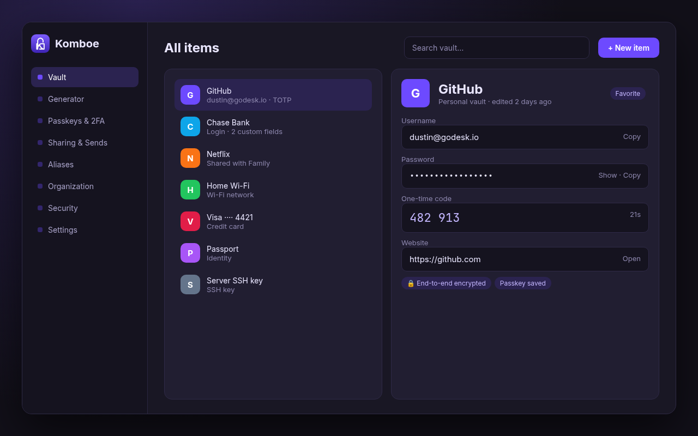 <i>Preview mockup — UI in development</i>

Unlimited logins, secure notes, cards, identities, SSH keys, Wi-Fi, passports, API secrets, GPG keys and bookmarks, with folders, tags, favorites, custom fields, attachments, item history, trash and offline access. Every item is encrypted on your device before it syncs.

**Where it came from:** Bitwarden clients and Vaultwarden (vault and item types); Psono (extra item types); KeePassXC and Passbolt (tags, history).

## Password, passphrase and username generator

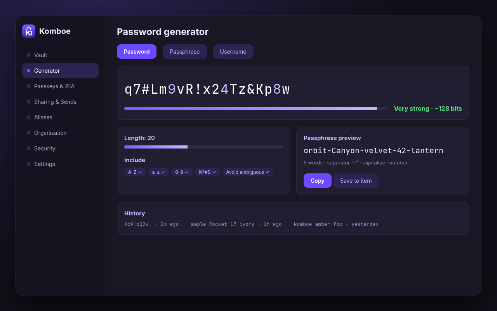 <i>Preview mockup — UI in development</i>

Strong passwords and memorable passphrases with a live strength meter, plus username generation and history.

**Where it came from:** Bitwarden clients, KeePassXC, Proton Pass.

## Autofill in every browser

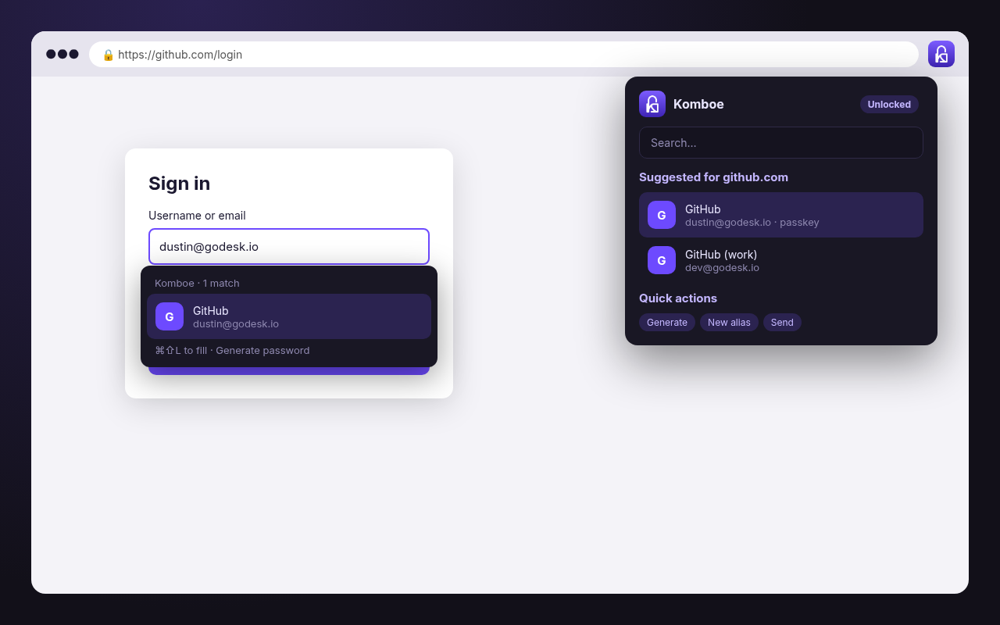 <i>Preview mockup — UI in development</i>

An inline in-form menu, keyboard shortcuts and a popup for Chrome, Edge, Brave, Opera, Vivaldi, Firefox, Safari and Tor Browser. On desktop, global auto-type.

**Where it came from:** Bitwarden browser extension; Proton Pass (inline UX); KeePassXC (auto-type).

## Passkeys, 2FA and a built-in authenticator

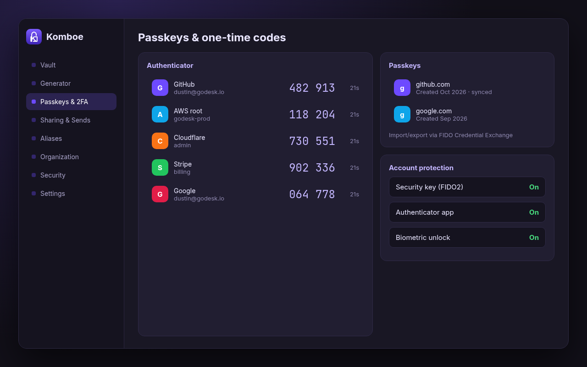 <i>Preview mockup — UI in development</i>

Store and autofill passkeys, import and export them via FIDO Credential Exchange, and keep TOTP codes next to your logins. Protect your account with security keys, an authenticator app, Duo/YubiKey or biometric/PIN unlock.

**Where it came from:** Bitwarden clients and Vaultwarden; Proton Pass; KeePassXC (YubiKey challenge-response).

## Secure sharing and Sends

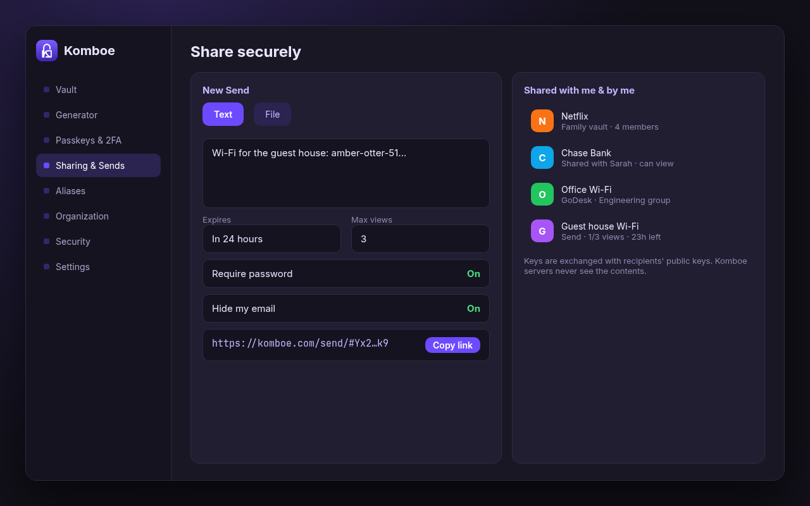 <i>Preview mockup — UI in development</i>

Share an item or a whole vault with people and groups, with per-vault permissions, or send expiring, view-limited, password-protected text and files. Sharing uses public-key encryption, so the server never sees what you share.

**Where it came from:** Bitwarden Send and Vaultwarden; Proton Pass and Psono (secure links); Passbolt and Padloc (group sharing).

## Hide-my-email aliases

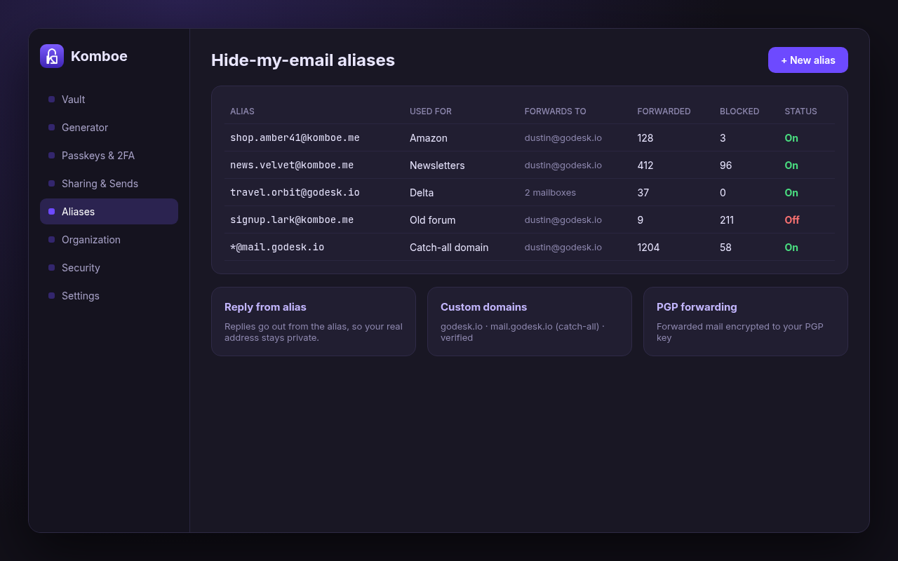 <i>Preview mockup — UI in development</i>

Create unlimited aliases, use custom domains and catch-alls, forward to multiple mailboxes, reply from the alias, PGP-encrypt forwarded mail, block senders and see stats.

**Where it came from:** SimpleLogin (alias server); Proton Pass (alias UX).

## Families and companies: admin seats, private personal vaults

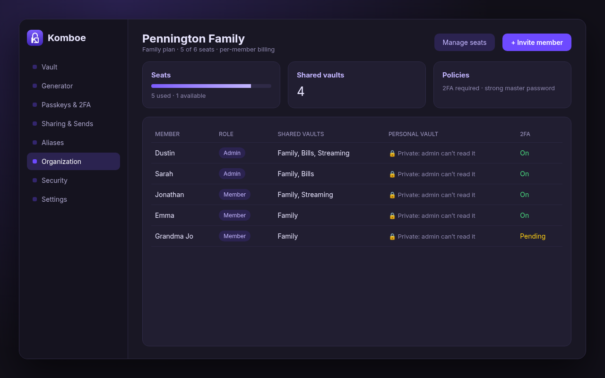 <i>Preview mockup — UI in development</i>

Organizations own shared vaults, and admins add or remove seats and set policies such as required 2FA. Families pay a small per-member fee. Every member keeps a personal vault the admin cannot read. Audit logs, a public API and clean-room SSO/SCIM are planned for companies.

**Where it came from:** Bitwarden, Vaultwarden, Passbolt, Padloc, Psono (orgs and RBAC). Per-member family pricing is original to Komboe.

## Family split-off

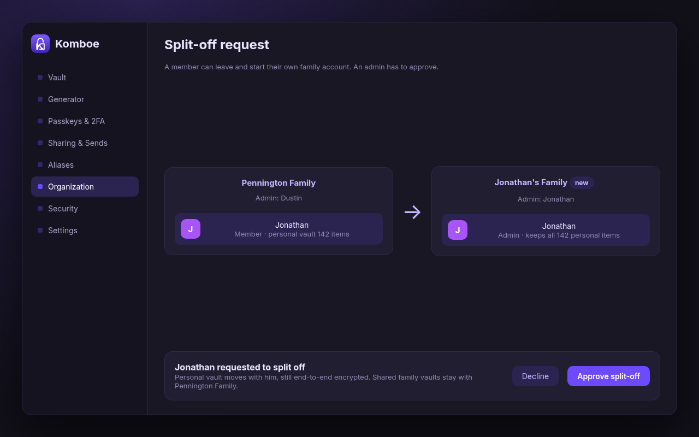 <i>Preview mockup — UI in development</i>

A member can ask to leave and start their own family account. Once an admin approves, the member keeps their whole personal vault, still end-to-end encrypted, and becomes admin of the new family.

**Where it came from:** Original to Komboe. No source project has this.

## Security reports and breach monitoring

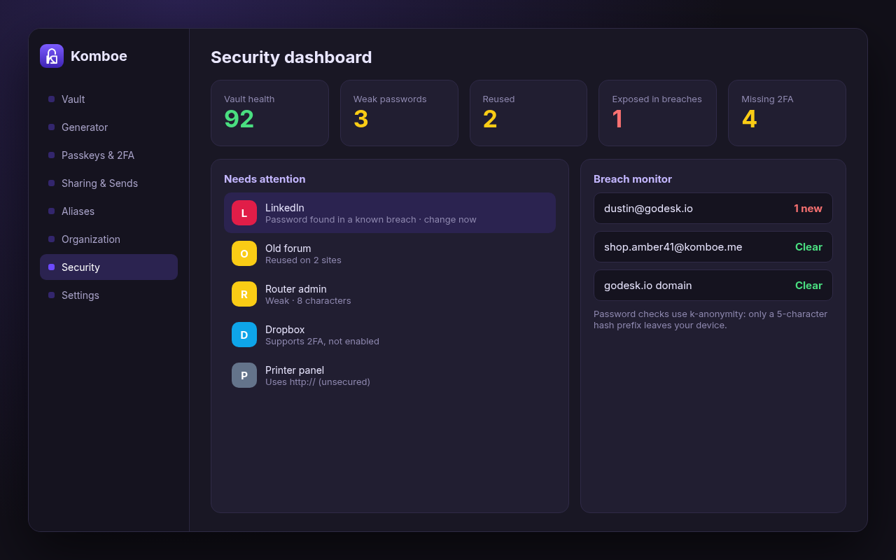 <i>Preview mockup — UI in development</i>

A vault health score, weak/reused/exposed password reports, missing-2FA and unsecured-site reports, and breach monitoring. Exposed-password checks use k-anonymity, so only a hash prefix leaves your device.

**Where it came from:** Bitwarden and Vaultwarden (reports); Proton Pass (monitor); KeePassXC and Psono (HIBP checks).

## Desktop and mobile apps

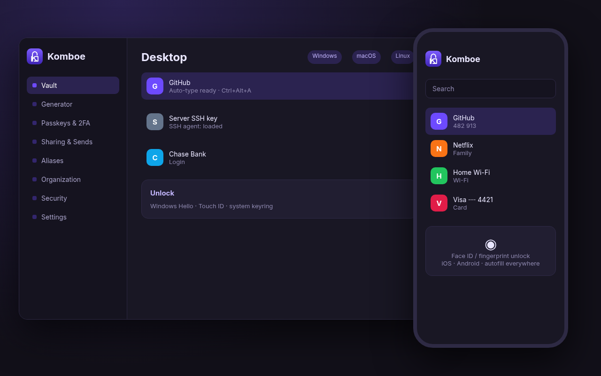 <i>Preview mockup — UI in development</i>

Native apps for Windows, macOS, Linux, iOS and Android, with biometric unlock, system autofill, an SSH agent, Secret Service integration and watch apps.

**Where it came from:** Bitwarden desktop and mobile; KeePassXC (Secret Service, auto-type); Proton Pass.

## Command-line interface

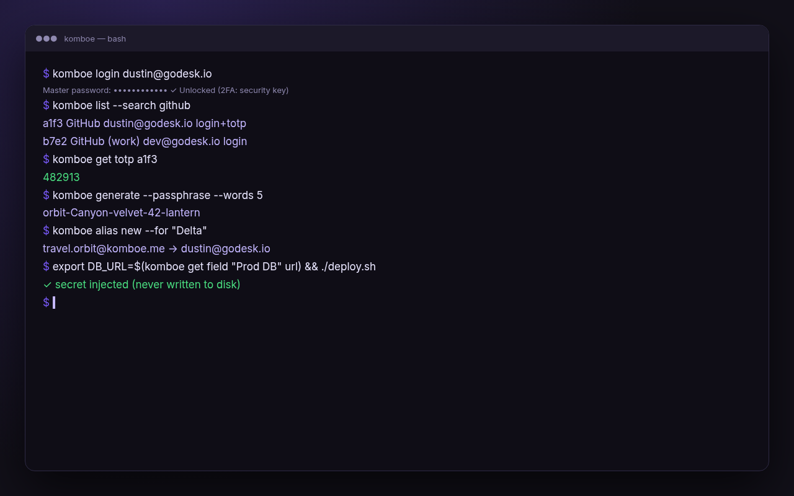 <i>Preview mockup — UI in development</i>

Script your vault: log in, search, read TOTP codes, generate passwords, create aliases and inject secrets into deploys.

**Where it came from:** Bitwarden CLI; KeePassXC CLI; Psono and Passbolt CLIs (ideas).

## Self-host or go hosted

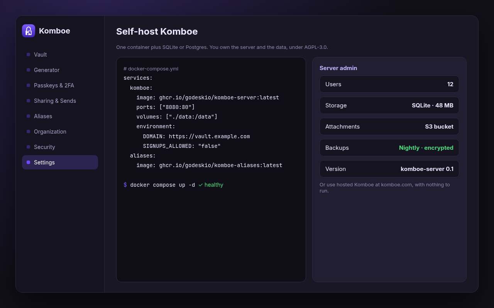 <i>Preview mockup — UI in development</i>

Run it all with Docker as a lightweight single binary with SQLite or Postgres, with S3 attachments and an admin page. Or use hosted Komboe at komboe.com.

**Where it came from:** Vaultwarden (server); SimpleLogin (aliases); Psono (storage backends).

## Excluded on purpose

Admin password reset and account recovery, Key Connector (org-held keys), Passbolt-style recovery, and anything under Bitwarden's `bitwarden_license/` are **not** part of Komboe. They conflict with the zero-knowledge, no-escrow design or aren't open source. See [docs/FEATURES.md](docs/FEATURES.md).

## Credits: all features under one roof

Komboe brings together the best ideas from these open-source projects. Each "Where it came from" line above points back here. No upstream logos or trademarked assets are used; all mockups and the padlock-K logo are original Komboe artwork.

| Project | License | What Komboe uses / learns from |
|---|---|---|
| [Bitwarden clients](https://github.com/bitwarden/clients) | GPL-3.0 (excluding `bitwarden_license/`) | Forked base for web, desktop, browser extension and CLI clients |
| [Vaultwarden](https://github.com/dani-garcia/vaultwarden) | AGPL-3.0 | Forked base for the Komboe server |
| [SimpleLogin](https://github.com/simple-login/app) | AGPL-3.0 | Email alias service |
| [Proton Pass](https://github.com/protonpass) | GPL-3.0 | Dashboard look-and-feel inspiration, alias UX |
| [KeePassXC](https://github.com/keepassxreboot/keepassxc) | GPL-2.0/3.0 | Offline vault and KDBX import/export ideas |
| [Passbolt](https://github.com/passbolt) | AGPL-3.0 | Team sharing ideas (its account recovery model is deliberately **not** adopted) |
| [Padloc](https://github.com/padloc/padloc) | AGPL-3.0 | Org/sharing UX ideas |
| [Psono](https://gitlab.com/psono) | Apache-2.0 | Self-hosted feature ideas |

**No endorsement.** Komboe is an independent project, not affiliated with, sponsored by, or endorsed by Bitwarden Inc., the Vaultwarden contributors, Proton AG, KeePassXC, Passbolt SA, Padloc, Psono, SimpleLogin, or any other listed project. All product names, logos and trademarks belong to their owners and appear here only to give credit. Upstream branding is removed from Komboe builds.

## License

[GNU AGPL-3.0](LICENSE). Third-party notices: [NOTICE](NOTICE).
